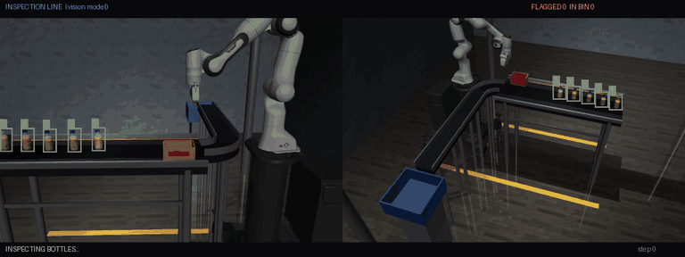
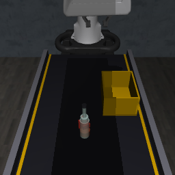
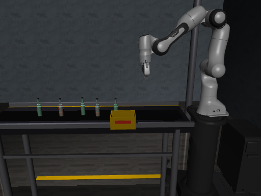

# VLA Defect Rejection

A simulated quality-control station: glass bottles ride along a conveyor belt, and a Franka Panda arm picks out the **defective** ones and drops them in a reject bin. Good bottles pass through. The arm is driven by a fine-tuned **[SmolVLA](https://huggingface.co/papers/2506.01844)** vision-language-action policy, with a scripted controller assisting.

The simulation is built on **[LIBERO](https://github.com/Lifelong-Robot-Learning/LIBERO)** (robosuite + MuJoCo). This repo adds a conveyor-belt environment, defect-rejection tasks, and a full data → training → inference pipeline using **[LeRobot](https://github.com/huggingface/lerobot)**.

<p align="center">
  <br>
  <em>Multi-bottle inspection: both defective bottles end up in the reject bin (side view, 3× speed).</em>
</p>

| Robot's camera view (`agentview`) | Multi-bottle scene (`sideview`) |
|---|---|
|  |  |

Defective bottles carry visible red cracks, a stain and a chip; good bottles are clean.

---

## What's in this repo

### Conveyor-belt simulation (added to LIBERO)

| File | What it does |
|---|---|
| [`libero/libero/envs/problems/conveyor_belt_manipulation.py`](libero/libero/envs/problems/conveyor_belt_manipulation.py) | The `conveyor_belt_manipulation` environment, including belt transport: bottles touching the belt are carried upright at belt speed, and lifted bottles are left to physics. |
| [`libero/libero/envs/arenas/conveyor_belt_arena.py`](libero/libero/envs/arenas/conveyor_belt_arena.py) | The belt arena. `belt_extension` lengthens the belt upstream without moving the robot or the task regions. |
| [`libero/libero/envs/objects/custom_objects.py`](libero/libero/envs/objects/custom_objects.py) | The `GlassBottle` (defective), `GoodBottle` and `RejectBin` objects. |
| [`libero/libero/assets/scenes/`](libero/libero/assets/scenes/) | Scene variants: `libero_conveyor_belt.xml` (industrial, the default), `_simple` and `_light`. |
| [`libero/libero/bddl_files/defect_rejection/`](libero/libero/bddl_files/defect_rejection/) | Task definitions: one defective bottle (`pick_defective_bottle_from_belt`) and five bottles, two of them defective (`multi_bottle_inspection`). |

### Pipeline scripts

| Step | Script |
|---|---|
| 1. Collect scripted demonstrations (HDF5) | [`collect_demos.py`](collect_demos.py) |
| 2. Convert them to a LeRobot dataset | [`convert_demos_to_lerobot.py`](convert_demos_to_lerobot.py) |
| 3. Fine-tune SmolVLA | [`train_smolvla.yaml`](train_smolvla.yaml) |
| 4. Run the policy on the multi-bottle line | [`inference_smolvla.py`](inference_smolvla.py) |
| Fully scripted reference demo | [`pipeline_demo.py`](pipeline_demo.py), [`rollout_smolvla.py`](rollout_smolvla.py) |
| Debugging and sanity checks | `debug_*.py`, `test_*.py` |

---

## Setup

Tested with Python 3.12, robosuite 1.4.0, lerobot 0.6.1 and PyTorch 2.11 on Linux with an NVIDIA GPU.

```bash
git clone https://github.com/me-nabi/vla-defect-rejection.git
cd vla-defect-rejection

python3.12 -m venv .venv && source .venv/bin/activate
pip install -e .                       # this repo's libero package
pip install robosuite==1.4.0 "lerobot[smolvla]" h5py imageio imageio-ffmpeg
```

> [!NOTE]
> Make sure `python -c "import libero; print(libero.__path__)"` points at this repo. Installing `lerobot[libero]` pulls in a separate copy of LIBERO (`hf_libero`) that will shadow it.

For headless machines, set `MUJOCO_GL=egl` before running any script.

> [!NOTE]
> The scripts currently use absolute paths (`/home/nabi/LIBERO/...`) in the constants at the top of each file. Change them to match your clone.

## Usage

```bash
# 1. Collect 50 scripted demos of the single-bottle task -> demos/conveyor_demos.hdf5
python collect_demos.py

# 2. Convert them to a LeRobot dataset -> lerobot_dataset/
python convert_demos_to_lerobot.py

# 3. Fine-tune SmolVLA (starts from a LIBERO-pretrained SmolVLA checkpoint)
lerobot-train --config_path=train_smolvla.yaml

# 4. Run the trained policy on the five-bottle conveyor line and record a video
python inference_smolvla.py              # opens a viewer
python inference_smolvla.py --headless   # video only
```

Policy inputs and outputs:
- **Observations:** two cameras (`agentview` and the wrist camera, 256×256), plus 8 numbers of robot state (7 joint positions and the gripper).
- **Actions:** 7 numbers for the end-effector (position change, rotation change, gripper), sent through an operational-space controller (OSC).
- **Language instruction:** *"pick the defective bottle from the conveyor belt and place it in the reject bin"*.

Datasets and checkpoints are not stored in git, because they are too large.

---

## Current status and limitations

This is a work in progress. Being upfront about what is and isn't learned:

- **Hybrid control.** SmolVLA steers the arm's first approach to a defective bottle. A scripted controller then does the grasp, lift and drop into the bin.
- **Defect detection isn't learned yet.** The CLEAN/DEFECT boxes in the demo video come from the simulator's true object positions and labels, not from a vision model.
- **Training data doesn't match deployment.** The current checkpoint was trained on single-bottle demos recorded with the belt stopped and different controller settings. Re-collecting demos under deployment conditions is the next step.
- **Drop into the bin is unreliable.** The scripted drop sometimes misses the bin's goal region.

### Roadmap
- [ ] One shared controller config for data collection and inference
- [ ] Demos recorded with the belt running, in multi-bottle scenes and the industrial scene, then retraining
- [ ] End-to-end policy control, with the script only as a fallback
- [ ] A learned defect detector to replace the true-position overlays
- [ ] An evaluation script reporting success rate and false rejections over many seeds
- [ ] Datasets and checkpoints published on the Hugging Face Hub

---

## Credits

This project builds directly on the work of others:

- **[LIBERO](https://github.com/Lifelong-Robot-Learning/LIBERO)** by Bo Liu, Yifeng Zhu, Chongkai Gao, Yihao Feng, Qiang Liu, Yuke Zhu and Peter Stone. The `libero/` package, its environments, assets and tooling come from LIBERO. The git history of the original project is available in [the upstream repository](https://github.com/Lifelong-Robot-Learning/LIBERO), and its original README, with installation, datasets and benchmark details, is [there](https://github.com/Lifelong-Robot-Learning/LIBERO#readme).
- **[SmolVLA](https://huggingface.co/papers/2506.01844)** and **[LeRobot](https://github.com/huggingface/lerobot)** by Hugging Face: the policy architecture and the training and dataset framework.
- **[robosuite](https://github.com/ARISE-Initiative/robosuite)**: the robot simulation framework underneath LIBERO.
- **[MuJoCo](https://mujoco.org/)**: the physics engine.

## Citations

If you use this work, please cite the projects it builds on:

```bibtex
@article{liu2023libero,
  title={LIBERO: Benchmarking Knowledge Transfer for Lifelong Robot Learning},
  author={Liu, Bo and Zhu, Yifeng and Gao, Chongkai and Feng, Yihao and Liu, Qiang and Zhu, Yuke and Stone, Peter},
  journal={arXiv preprint arXiv:2306.03310},
  year={2023}
}

@article{shukor2025smolvla,
  title={SmolVLA: A Vision-Language-Action Model for Affordable and Efficient Robotics},
  author={Shukor, Mustafa and others},
  journal={arXiv preprint arXiv:2506.01844},
  year={2025}
}

@misc{cadene2024lerobot,
  author={Cadene, Remi and Alibert, Simon and Soare, Alexander and Gallouedec, Quentin and Zouitine, Adil and Palma, Steven and Kooijmans, Pepijn and Aractingi, Michel and Shukor, Mustafa and Aubakirova, Dana and Russi, Martino and Capuano, Francesco and Pascal, Caroline and Choghari, Jade and Moss, Jess and Wolf, Thomas},
  title={LeRobot: State-of-the-art Machine Learning for Real-World Robotics in Pytorch},
  howpublished={\url{https://github.com/huggingface/lerobot}},
  year={2024}
}

@article{zhu2020robosuite,
  title={robosuite: A Modular Simulation Framework and Benchmark for Robot Learning},
  author={Zhu, Yuke and Wong, Josiah and Mandlekar, Ajay and Mart{\'i}n-Mart{\'i}n, Roberto and others},
  journal={arXiv preprint arXiv:2009.12293},
  year={2020}
}

@inproceedings{todorov2012mujoco,
  title={MuJoCo: A physics engine for model-based control},
  author={Todorov, Emanuel and Erez, Tom and Tassa, Yuval},
  booktitle={2012 IEEE/RSJ International Conference on Intelligent Robots and Systems},
  pages={5026--5033},
  year={2012}
}
```

## License

MIT. See [LICENSE](LICENSE). The original LIBERO code is © its authors under the MIT license, and that notice is kept in `LICENSE`.
